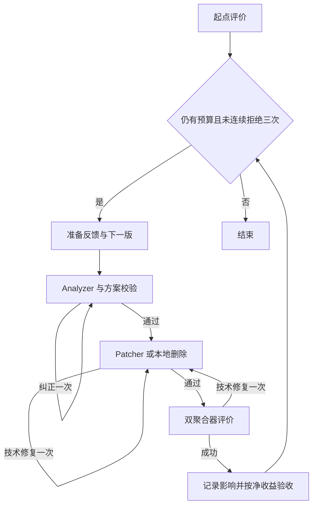

# SMS：Benchmark LF 迭代

本目录以 WRENCH / SMS 的固定划分运行 [Benchmark 统一流程](../README.md)，独立保存 LF 版本、指标和调用用量。标签为 `0=ham`、`1=spam`、`-1=弃权`。LF 只接收正文字符串，训练金标不传给 LF 或 LLM。

## 数据与环境

| 集合 | 条数 | 字段 | 用途 |
| --- | ---: | --- | --- |
| [data/train.csv](data/train.csv) | 4571 | id,text | LF 投票、Snorkel 拟合、弱标签生成 |
| [data/valid.csv](data/valid.csv) | 500 | id,text,label | 开发指标、Analyzer 反馈和候选验收 |
| [data/test.csv](data/test.csv) | 500 | id,text,label | 预测与最终评估，不进入 LLM 反馈 |

[data/split.json](data/split.json) 固定来源、划分和 CSV 哈希；启动时复用并校验，不重新抽样。Snorkel 使用 CPU、500 epochs、seed 42，并以完整验证集的类别比例 `[0.872, 0.128]` 为先验；这部分金标计入监督预算。所有 LF 弃权时最终也弃权。

每次评价复用同一批 LF 投票，分别运行 Snorkel 和 `simple_vote`。简单投票对每个非弃权 LF 计一票，取唯一多数类；平票或全弃权时输出弃权，不拟合参数、不使用类别先验。两者是生成弱标签的聚合器，Analyzer 使用简单投票的验证指标、样例预测和分组，候选验收使用 Snorkel。

在实际实验 Python 环境中安装 [requirements.txt](requirements.txt)，它引用项目根目录的共同依赖：

```powershell
# 从项目根目录执行。
python -m pip install -r benchmark/SMS/requirements.txt
```

追加迭代读取项目根目录 `.env` 中的 `DEEPSEEK_API_KEY`、`DEEPSEEK_MODEL` 和可选的 `DEEPSEEK_BASE_URL`，未配置地址时使用官方默认地址。路径由 `benchmark/SMS/` 定位，与启动时的工作目录无关；仅评价已有版本不需要 API Key。

## 运行

入口 [orchestrator.py](orchestrator.py) 保留参数和命令行交互，[workflow.py](workflow.py) 使用 LangGraph 编排，版本汇总和日志由 [tools/records.py](tools/records.py) 保存。依赖固定为 `langgraph==1.1.10`。



分析和修改的尝试次数在每轮开始时清零。生成校验和候选评价共用一次 LF 修复额度；删除、API/文件错误和影响记录错误按既有策略停止。图节点不启用额外自动重试，模型请求和 Token 记账继续使用 `tools/llm.py`，输入仅由反馈白名单构造。本次使用内存状态编排，不启用检查点持久化或自动累加对话历史。

从项目根目录执行：

```powershell
# 交互输入起点版本和追加轮数。
python -B benchmark/SMS/orchestrator.py

# 评价已有 v1 的两种聚合器并更新迭代表，不调用 LLM。
python -B benchmark/SMS/orchestrator.py --version v1 --iterations 0

# 从已有 v1 追加一轮，会调用配置的 API。
python -B benchmark/SMS/orchestrator.py --version v1 --iterations 1

# 使用 0.02 门槛做敏感性对照。
python -B benchmark/SMS/orchestrator.py --version v1 --iterations 5 --acceptance-epsilon 0.02

# 单版评价两种聚合器，不更新 iterations.csv。
python -B benchmark/SMS/tools/runner.py --version v1
```

也可进入 `benchmark/SMS/` 后执行 `python -B orchestrator.py --version v1 --iterations 0`。版本、数据和输出始终定位到本目录。

## 候选验收与停止

只用 Snorkel 在完整验证集上的聚合输出验收。对每个真实类别，记标对数为 C、误标数为 W、总样本数为 M，弃权只计入 M：

```text
Q = 0.5 * ((C_ham - W_ham) / M_ham + (C_spam - W_spam) / M_spam)
接受当且仅当 Q(候选) - Q(当前) > 0.01
```

误标惩罚固定为 1，两个类别等权。默认门槛可用 `--acceptance-epsilon` 改动；等于门槛也拒绝。覆盖率、测试指标、`simple_vote` 和 LR/BERT 均不参与验收。

接受才更新当前版本并清空连续拒绝记录。拒绝后仍保存候选；下一轮从保留版出发，并告知 Analyzer 之前未通过的方案。达到 `--iterations` 上限或连续拒绝 3 个有效候选时停止，技术修复不算拒绝。新候选使用现有最大版本号加一，即使从旧版开始也不会覆盖已有候选。每个新候选的 `results/decision.json` 记录父版本、验收状态、分数和门槛。

## Analyzer 输入与输出

[tools/feedback.py](tools/feedback.py) 独立构造父版本的训练/验证反馈，每轮调用 Analyzer 前保存到候选版本的 `versions/vN/results/feedback.json`。
反馈包含 LF 源码、验证指标、训练统计和五组样例；有连续拒绝时另附尝试过的方案。不包含测试信息。
Analyzer 纠正时复用同一份反馈；仅评估（0 轮）不生成反馈文件。

[orchestrator.py](orchestrator.py) 顶部配置每轮最多修改 5 个 LF、五组样例各最多 30 条、抽样 seed 42 和 LF 覆盖阈值 0.8。程序根据训练/验证 LF 覆盖率计算 `coverage_context`，将覆盖目标、阈值和改动上限与完整开发反馈一起传给 Analyzer。

反馈中的 `lf_names` 保留完整 LF 名单，样例 `votes` 只列非弃权的 `0/1` 票；未列出的 LF 表示 `-1`，全部弃权时为 `{}`。此压缩只用于发送给 Analyzer，本地 `lf_votes.csv` 和聚合计算仍使用完整投票矩阵。

Analyzer 每轮选择一个统一的 `action`，只返回：

```json
{
  "action": "modify",
  "summary": "本轮优先解决的缺口及主要风险",
  "operations": [
    {
      "target": "lf_prize",
      "reason": "为什么修改",
      "evidence": ["给定样例、统计或代码依据"],
      "plan": "具体匹配思路、需要保留的行为和弃权边界"
    }
  ]
}
```

覆盖上下文仅作为输入，不要求模型重新生成，也不追加到分析结果。`action` 为 `add`、`modify` 或 `delete`；每项操作继承该类型，不重复输出。`summary`、`reason`、`plan` 为非空字符串，`evidence` 为非空字符串数组。

[tools/analyzer.py](tools/analyzer.py) 集中检查字段及类型、有效且不重复的函数名、目标与当前 LF 列表的关系、操作数量和删除后至少保留 3 个 LF。新增和修改时，Patcher 在一次调用中只输出计划涉及的全部目标函数定义；程序按源码位置在本地合并，未涉及的函数、模块导入、常量和辅助函数保持原文。新增函数按提案顺序加入 `LFS`，修改保留原顺序，删除直接在本地移除函数并更新列表，不调用 Patcher。

Patcher 回复不能包含整个文件、额外函数或模块级语句。AST 校验检查目标函数是否完整且与计划一致，再核对实际改动数量和操作类型。技术失败最多修复一次，反馈前次目标函数源码和具体错误；缺失、多余函数或未落实的操作会列出名称。共享常量可引用原文件已有定义，新导入仅写在目标函数内部。

Analyzer 回复直接使用标准 JSON 解析，不再自动补反斜杠。JSON 解析失败或结构/操作校验失败时，工作流将原始任务上下文、原回复和具体错误交回同一个 Analyzer，最多纠正一次；成功则继续 Patcher，再次失败则停止。字段错误包含位置及实际值，例如 `operations[0].target` 或 `operations[1].evidence[0]`。正常情况只调用一次 Analyzer；网络、鉴权、文件错误，以及 API 返回的空回复或截断回复直接停止，不触发纠正。

## 输出

每个版本直接包含两个聚合器结果目录：

```text
versions/vN/
├── lfs.py
├── Snorkel/
│   ├── metrics.json / metrics.csv / report.md
│   ├── weak_labels.csv
│   ├── snorkel_model.pkl
│   └── impact.json / impact.md / impact_samples.csv  # 有比较起点时生成
├── simple_vote/
│   ├── metrics.json / metrics.csv / report.md
│   ├── weak_labels.csv
│   └── impact.json / impact.md / impact_samples.csv
└── results/
    ├── lf_votes.csv / lf_quality.csv               # 两种聚合器共用
    ├── feedback.json                             # 生成本候选所用的父版本反馈
    ├── analysis*.json / patcher*.txt / changes.md / errors.json
    └── decision.json                             # 本候选的验收结果
```

共用的 LF 投票和质量只在 `results/` 保存一份，聚合器报告链接到这份共用数据；`Snorkel/` 和 `simple_vote/` 各自保存指标、弱标签及影响记录。简单投票的 `p_ham/p_spam` 表示非弃权票占比，全弃权时占位为 `0.5/0.5`，不代表校准后的概率；它没有需要保存的拟合模型。

`report.md` 只展示主要指标表。`metrics.json` 保留主指标、各类 Precision/Recall/F1、混淆矩阵、必要配置和数据哈希，删除重复样本数、LF 名单及冗余说明字段；详细指标继续保留在 `metrics.csv`。

新运行的分析、改动、评价和验收归候选版本；历史文件不迁移。`analysis.json` 使用上述精简结构，`changes.md` 记录统一操作类型、摘要及逐项原因。`iterations.csv` 按版本和聚合器各保存一行（包括被拒绝的候选），`tokens.csv` / `tokens.md` 记录真实调用用量。

候选版本的 `results/analysis_raw.txt` 保存首次 Analyzer 原回复，`analysis_repair_raw.txt` 单独保存纠正回复；只有通过校验才保存 `analysis.json`。合法 JSON 未通过业务校验时，首次和纠正结果分别另存 `analysis_invalid.json`、`analysis_repair_invalid.json`。`results/errors.json` 记录失败阶段与尝试次数，纠正成功后也保留首次失败记录。Token 用量分别计入 `Analyzer` 和 `Analyzer 修复`，CSV 表头保持不变。

下一版本的 `results/patcher_raw.txt` 与 `patcher_repair_raw.txt` 分别保存目标函数的首次及修复原回复，`lfs.py` 保存本地合并后的完整源码。删除操作不生成 Patcher 回复文件，也不产生该阶段 API 用量。

## 修改影响记录

每轮候选成功评价后，分别比较本轮起点和新版本的同一种聚合器，在新版本 `Snorkel/` 和 `simple_vote/` 中保存：

- `impact.json`：训练/验证主要变化、发生变化的 LF 及其票数、验证质量变化和输入文件 SHA-256。
- `impact.md`：覆盖、预测变化及验证质量的简表。
- `impact_samples.csv`：全部训练/验证样本（含未变化样本），包含正文、前后预测/概率、变化的 LF 投票和验证正确性；训练金标列为空。

已有版本也可直接补记，不执行 LF、不重新训练、不调用 LLM：

```powershell
python -B benchmark/SMS/tools/impact.py --old-version v9 --new-version v10

# 只补记一种聚合器。
python -B benchmark/SMS/tools/impact.py --old-version v9 --new-version v10 --aggregator simple_vote
```

记录只使用训练集和验证集。按样本 ID 和 LF 名称对齐，新增/删除 LF 的缺失列视为弃权；同票增加属于投票变化，不一定产生新增覆盖。LF 覆盖与聚合输出覆盖分别统计，聚合类别翻转仅指 ham/spam 互换，弃权变化另计。JSON 的 `changed_lfs` 只列投票发生变化的 LF 和变化票数，未变化项省略；更细的状态变化可从 `impact_samples.csv` 查看。

概率使用各聚合器 `weak_labels.csv` 的六位小数值；最大类别概率差严格大于 `1e-6` 才计为概率变化，简单投票比较的是票占比变化。验证集修复为错误/弃权变正确，退化为正确变错误/弃权；新增误标另计正确/弃权变错误。这些计数可能重叠，训练集不判断修复或退化。Snorkel 聚合变化包含重新拟合 LabelModel 的影响，逐 LF 投票差异不代表单个 LF 对聚合变化的因果贡献。

影响记录从 `results/lf_votes.csv` 读取共用投票，从所选聚合器目录读取指标和弱标签。写入前核验数据哈希、完整且唯一的 ID、正文、投票列、聚合器、概率及指标一致性；不静默丢弃不匹配样本。命令默认重新生成两种聚合器的三份影响记录，报告内注明实际比较起点和聚合器。`input_sha256` 的路径相对于对应版本目录。更新共用投票时会移除该版两种聚合器的旧影响记录；重跑比较起点后，应对后续比较重新执行命令。

影响记录仅用于诊断，不加入 Analyzer/Patcher，也不参与验收。记录阶段失败写入 `errors.json` 的 `Impact` 阶段并停止，不触发额外 Patcher 调用。

测试正文、标签和指标不进入 Analyzer/Patcher，也不用于选择操作。冻结本次运行的保留版后，建议给下游命令显式传 `--version`；LR/BERT 未指定版本时按验证 Macro-F1 挑选，并跳过有明确拒绝记录的候选。

## 逻辑回归下游模型

```powershell
python -B benchmark/SMS/tools/train_logistic.py --version v5
```

分别使用 `Snorkel/weak_labels.csv` 和 `simple_vote/weak_labels.csv` 中非弃权的训练硬标签，训练词 TF-IDF（1–2 gram，最多 100,000 特征，sublinear_tf）＋逻辑回归。词表、IDF 和 LR 系数只拟合各自保留的训练样本；验证集 spam F1 从 C=[0.1,1,10] 中选参，同分取第一个。使用 liblinear、max_iter=2000、seed=42，完整验证/测试预测且不弃权。上游 Snorkel 使用验证类别先验的情况保留在结果配置中。

各聚合器的 `tfidf_lr_results/` 保存 `model.joblib`、精简 `metrics.json` / `report.md` 和验证/测试预测 CSV；预测通过 ID 对应共用数据，不复制正文。命令不调用 LLM；可用 `--aggregator Snorkel` 或 `--aggregator simple_vote` 单独训练。
