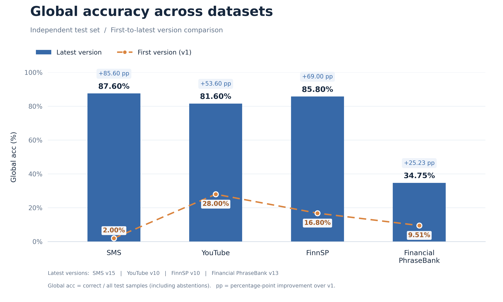
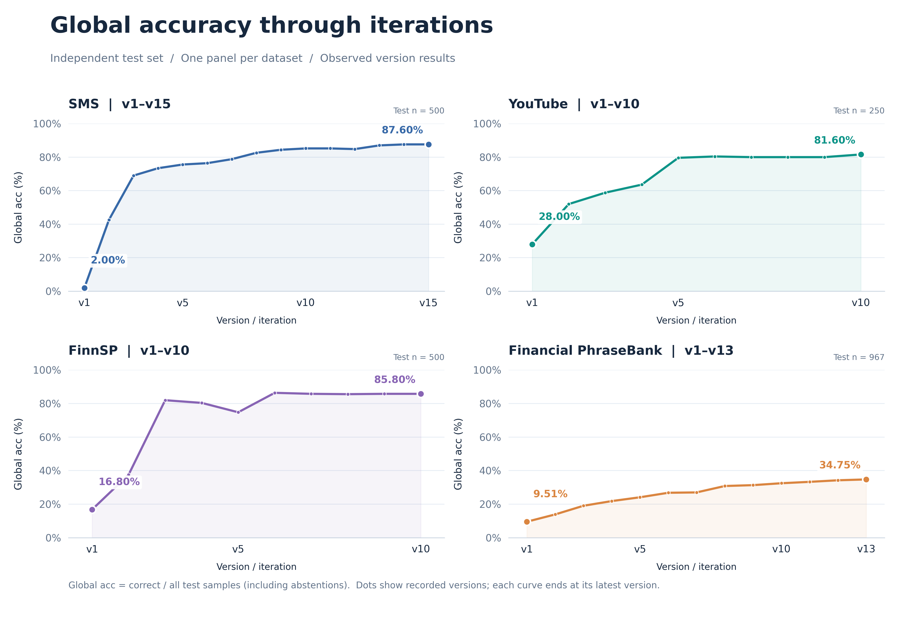

# 四个数据集的 Global Acc 汇总

Yelp v10、IMDb v10、CHECKED v15、AGnews v10 的下游模型见 [逻辑回归汇总](downstream_lr_summary.md)（[CSV](downstream_lr_summary.csv)）。





## 统计口径

- 使用独立测试集 `test.all_samples.accuracy`，即正确预测数 / 测试集总样本数；弃权计入分母。
- 仅统计含 `results/metrics.json` 的已评估版本，首版、最新版按版本号数字排序；最新版不是历史最优版本。
- 蓝色柱表示各数据集最新版；橙色虚线连接各数据集首版（均为 v1）的结果。横轴是数据集，不是迭代时间。
- 提升以百分点（pp）表示，由未舍入的准确率相减得到。图表和下表保留两位小数，CSV 保留原始精度。

- 迭代图采用 2×2 子图，每个数据集独立展示已评估版本的测试集 Global Acc；纵轴统一为 0%–100%，横轴按实际版本范围绘制。
- 曲线保留原始波动，不做平滑；标注首版与最新版的准确率，不对较早结束的数据集补值。

## 结果

| 数据集 | 首版 | 首版 Global Acc | 最新版 | 最新版 Global Acc | 提升 (pp) | 测试样本数 | 正确数（首版 → 最新版） |
| --- | --- | ---: | --- | ---: | ---: | ---: | ---: |
| SMS | v1 | 2.00% | v15 | 87.60% | +85.60 | 500 | 10 → 438 |
| YouTube | v1 | 28.00% | v10 | 81.60% | +53.60 | 250 | 70 → 204 |
| FinnSP | v1 | 16.80% | v10 | 85.80% | +69.00 | 500 | 84 → 429 |
| Financial PhraseBank | v1 | 9.51% | v13 | 34.75% | +25.23 | 967 | 92 → 336 |

## 未完成评估的版本

- Financial PhraseBank v14：存在失败记录，未计入图表。

## 数据来源

- SMS：[v1](../SMS/versions/v1/results/metrics.json)；[v15](../SMS/versions/v15/results/metrics.json)
- YouTube：[v1](../YouTube/versions/v1/results/metrics.json)；[v10](../YouTube/versions/v10/results/metrics.json)
- FinnSP：[v1](../Finnsp/versions/v1/results/metrics.json)；[v10](../Finnsp/versions/v10/results/metrics.json)
- Financial PhraseBank：[v1](../financial_phrasebank/versions/v1/results/metrics.json)；[v13](../financial_phrasebank/versions/v13/results/metrics.json)

## 文件与复现

- `global_acc_comparison.png`：3600 × 2160，300 dpi。
- `global_acc_comparison.svg`：矢量图，可用于论文或幻灯片排版。
- `global_acc_summary.csv`：原始准确率（0–1）、版本、样本数、正确数、提升百分点及来源路径。
- `global_acc_iterations.png` / `.svg`：四个数据集的迭代折线组合图（2×2），PNG 为 4200 × 2850，300 dpi。
- `global_acc_iterations.csv`：各数据集已评估版本的原始准确率、样本数、正确数及来源路径。
- `plot_global_acc.py`：自动读取四个数据集的已评估版本，重新生成上述图表和本说明，并列出未完成版本。

在项目根目录运行（需要 Matplotlib、NumPy）：

```powershell
python -B tasks/report/plot_global_acc.py
```
