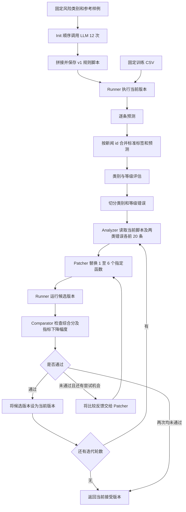

# Workflow V4 完整工作流程与实现细节

核对日期：2026-09-14。本文依据当前目录源码、固定数据、v1–v12 脚本及已有报告整理。已离线执行全部 12 个版本的 `predict`，在内存中重新计算类别和等级指标，结果与已有报告全部一致；没有调用在线 LLM，没有重新生成版本或覆盖历史报告。

## 1. 系统定位和阅读范围

实际目录是 `workflows/v4`。这里的 V4 表示整套工作流；`versions/v1` 到 `versions/v12` 是这套工作流内的规则脚本版本，两层版本号不能混为一谈。

系统将加密新闻转成“多个风险类别 + 一个整体风险等级 + 解释原因”。LLM 负责生成、分析和修改 Python 规则，预测阶段则执行本地规则。

工作对象有三层：

| 对象 | 具体含义 | 如何变化 |
|---|---|---|
| 风险类别体系 | 固定的 12 个风险类别 | 当前自动迭代不修改 |
| 规则脚本 | `lf_01`–`lf_12`、辅助函数、`predict`、`label_csv` | LLM 生成，后续局部替换 |
| 预测和评估报告 | 每条新闻的预测、指标、错误样本、修改分析 | 每次运行当前版本重新产生 |

“不使用风险分数”指每条新闻不输出连续风险评分；版本比较时仍有一个用于选版本的综合质量分，两者不同。

当前默认运行版本仍是 `v1`，不是自动寻找编号最大的版本。现存最高编号是 `v12`；按当前指标权重，现存脚本中综合分最高的是 `v11`。`v12` 的已有比较报告明确标记为不接受。

## 2. 总体流程



Init 是单独入口，orchestrator 不会自动执行它。已有脚本可以直接从 Runner 开始，不需要重新生成 v1。

## 3. 文件职责与依赖关系

| 文件 | 具体职责 | 主要输入 | 主要输出 |
|---|---|---|---|
| `artifacts/vocabulary.json` | 规定类别顺序和名称 | 固定配置 | 12 类字符串列表 |
| `artifacts/examples.json` | 为每类 LF 提供参考样例 | 固定标注样例 | Init 的提示词上下文 |
| `data/crypto_news_train.csv` | 提供新闻及标准标签 | 已准备好的数据 | 所有版本共同使用的数据 |
| `init.py` | 逐类生成首版 LF 并组装 | 词表、样例、LLM | `versions/v1/script_v1.py` |
| `tools/runner.py` | 串联预测、合并、评估、切错 | 指定版本脚本、训练集 | CSV 和 JSON 报告 |
| `tools/paths.py` | 统一生成路径并创建父目录 | `v数字` 格式版本号 | 路径字典 |
| `tools/common.py` | CSV/JSON 读写、类别解析、二分类指标 | 文件或标签列表 | 数据对象、指标 |
| `tools/merger.py` | 按 id 对齐标准答案与预测 | gold CSV、prediction CSV | `merged.csv` |
| `tools/evaluator.py` | 分别计算多标签类别和单标签等级指标 | 合并数据、词表 | 两份指标 JSON |
| `tools/slicer.py` | 分别保存类别错误和等级错误 | 合并数据 | 两份 mismatch CSV |
| `analyzer.py` | 让 LLM 分析错误并指定目标函数 | 源脚本、两类错误各前 20 条 | `analysis.json` |
| `patcher.py` | 让 LLM 只返回目标函数替换代码 | 源脚本、分析、反馈 | 下一版本脚本、patch 报告 |
| `tools/comparator.py` | 判定候选是否优于来源版本 | 两版本已有指标 | comparison JSON |
| `orchestrator.py` | 控制迭代、反馈重试、接受或停止 | 起始版本、轮数 | 返回最后接受的版本号 |

目录内没有数据抓取、gold 标注、训练/测试划分的自动步骤。那些工作不属于当前 V4 执行链；标准答案在进入流程前已经存在。

## 4. 第一步：准备类别、样例和训练数据

### 4.1 固定 12 类及 LF 对应关系

对应关系由词表顺序决定：第一个类别对应 `lf_01`，依次到 `lf_12`。

| LF | 风险类别 | 当前数据中正样本数 | Init 参考样例数 |
|---|---|---:|---:|
| `lf_01` | 链上漏洞 / 攻击风险 | 65 | 5 |
| `lf_02` | 诈骗 / 跑路 / Rug Pull 风险 | 17 | 5 |
| `lf_03` | 监管与法律风险 | 28 | 5 |
| `lf_04` | 交易所与系统运维风险 | 6 | 5 |
| `lf_05` | 稳定币异常风险 | 2 | 2 |
| `lf_06` | 爆仓 / 清算风险 | 40 | 5 |
| `lf_07` | 大额转账 / 巨鲸行为风险 | 24 | 5 |
| `lf_08` | 异常行情波动风险 | 27 | 5 |
| `lf_09` | 项目治理 / 团队异常风险 | 18 | 5 |
| `lf_10` | 偿付能力 / 储备 / 流动性风险 | 29 | 5 |
| `lf_11` | 基础设施 / 协议层异常风险 | 20 | 5 |
| `lf_12` | 宏观 / 政策冲击风险 | 13 | 5 |

另有 6 条“无明显风险”参考样例，会加入每一次 LF 生成请求。正例按类别累计 57 条，加上反例共 63 个样例条目；由于多标签新闻会出现在多个类别下，实际去重后为 47 个新闻 id，全部与当前训练集 id 重合。

每个参考样例包含新闻 id、内容、风险等级、风险类别列表、原因。同一条正例可能包含多个类别，等级是新闻整体等级，没有为每个类别分别提供标准等级。因此单个 LF 如何赋级由 LLM 根据这些整体标注归纳，并不存在现成的类别级等级监督表。

`vocabulary.json` 实际仅存类别名称，不包含关键词词典；具体关键词写在生成后的 Python 函数中。

### 4.2 数据字段与分布

当前数据共 1000 条，新闻 id 全部唯一，内容无空白值，字段如下：

| 字段 | 用途 |
|---|---|
| `新闻id` | 合并标准标签和预测的唯一键 |
| `时间` | 原样保留在输出中，不参与当前规则预测 |
| `内容` | 传给 `predict(text)` 的唯一预测输入 |
| `风险等级` | 标准答案，`low / medium / high` |
| `风险类别` | 标准答案，CSV 单元格中保存 JSON 数组字符串 |
| `原因` | 标注解释；用于错误分析上下文，不参与数值指标计算 |

等级分布：low 870、medium 80、high 50。782 条类别为空数组，218 条有至少一个类别；各类别 support 总和为 289，因为一条新闻可对应多个类别。

`low` 不等于“类别一定为空”。例如新闻 id 24 的标准等级为 low，但具有“大额转账 / 巨鲸行为风险”类别。系统将是否命中某类和整体严重程度分别表达。

同一份数据用于预测评估、错误分析和候选版本选择，没有独立验证集/测试集。本文的指标都是这 1000 条数据上的结果，不能解释为未见新闻的泛化成绩。

## 5. 第二步：Init 生成第一版规则

实现：`init.py`。

### 5.1 环境与客户端

从项目根目录 `.env` 加载配置：

| 配置 | 默认值或要求 |
|---|---|
| `DEEPSEEK_API_KEY` | 必须存在，代码用 `os.environ[...]` 读取 |
| `DEEPSEEK_MODEL` | 默认字符串 `deepseek-v4-pro` |
| `DEEPSEEK_BASE_URL` | 默认 `https://api.deepseek.com` |
| `TEMPERATURE` | 0.1 |
| 响应格式 | `response_format={"type": "json_object"}` |

以上是代码中的配置，不代表本次核查已验证在线服务或模型可用性。客户端使用 OpenAI SDK 的兼容接口。Init、Analyzer、Patcher 各自在模块导入时加载配置并创建客户端；Runner 本地运行不依赖这些模块，因此不需要在线 API。

### 5.2 每个 LF 的生成过程

1. 检查词表长度为 12，且每个类别都在样例字典中。
2. 按词表顺序配对 `lf_01`–`lf_12`。
3. 为当前类别构造一次独立请求，包含函数名、类别名、本类正例、共同的 6 条反例。
4. 提示 LLM 参考新闻内容、等级和原因，使用 `hit(text, words)` 检查关键词。
5. 要求函数只接收 `text`，不命中返回 `None`；命中返回 `(risk_type, level, reason)`。
6. 要求等级只能为 low、medium、high，不要风险分数，不要 import 或额外函数。
7. LLM 返回 JSON，其 `code` 字段保存完整函数代码。
8. 用 `ast.parse` 解析，检查顶层普通函数列表是否恰好为目标函数，检查代码中包含指定类别字符串，并禁止 `risk_score` 和“风险分数”两个字符串。
9. 顺序完成 12 次请求后，拼接固定头部、12 个 LF、固定尾部，再检查整个脚本语法。
10. 写入 `versions/v1/script_v1.py`。

固定头部提供 `json`、`pandas`、等级顺序表和 `hit`。固定尾部提供 `LFS`、`predict` 和 `label_csv`。

Init 当前没有自行编写的失败重试循环；某一 LF 返回非法结果会中断，没有逐 LF 检查点文件。输出路径固定，重新执行成功会覆盖原来的 v1 脚本。

### 5.3 校验的实际边界

Init 的 AST 检查不等于完整执行契约检查：没有逐个检查 return 的类型、tuple 长度、等级取值、函数参数签名，也没有禁止函数体内部 import。即使提示词要求不要其他顶层语句，`validate_lf` 也没有像 Patcher 那样要求整个 AST 只能含一个节点。因此语法通过仍可能留下行为错误。

已有 v1 就存在真实例子：`lf_03` 把字符串 `w` 直接传给 `hit(text, w)`，而 `hit` 将第二个参数当作可迭代词表。字符串会被逐字符遍历，`rug pull` 中的空格也变成匹配项，产生大量高风险误报。当前 1000 条上的 v1 等级 Accuracy 只有 0.05，高风险 Recall 却是 1.0。v2 将这类调用改成完整词语的子串判断。

## 6. 第三步：Runner 加载脚本并逐条预测

入口：`run_version(version, show_metrics=True, show_progress=True)`。一共四步：预测、合并、评估、切错。

### 6.1 构建路径和加载模块

`build_paths` 要求版本格式严格匹配 `v\d+`。它根据版本构造输入、脚本和各报告路径，并创建所需父目录。因此调用路径函数也可能创建空报告目录。

`load_labeler` 使用 `importlib.util.spec_from_file_location` 动态加载指定脚本并执行模块顶层代码，只显式检查模块是否有 `label_csv`。这里没有隔离执行沙箱，也没有逐 LF 返回值验证；生成脚本在当前 Python 进程中执行。

### 6.2 一条新闻如何得到结果

首版固定聚合逻辑和当前 v11/v12 的核心行为一致：

1. 按 `LFS` 列表顺序执行全部 12 个函数。
2. 收集所有非 `None` 结果。一类未命中不会阻止其他类继续执行。
3. 没有任何结果时返回 `("low", [], "未命中风险 LF")`。
4. 有结果时提取类别，按首次出现顺序去重，不按字母排序。
5. 用 `LEVEL_ORDER={"low":0,"medium":1,"high":2}` 取所有命中等级的最大值，作为整条新闻等级。
6. 用中文分号 `；` 顺序拼接所有命中原因，不对原因去重，也不再调用 LLM 改写。

这不是投票：一个 high 就足以把整条新闻判为 high，其他 low 不会抵消它。规则之间没有学习权重、置信度校准或冲突仲裁。

历史版本 v3–v5 曾经修改过 `predict`，包含观点文本的整体降级或提前返回；不能将 v11/v12 的具体聚合行为直接套在所有历史版本上。

### 6.3 批量 CSV 输出

`label_csv` 用 pandas 读取 UTF-8 BOM 兼容 CSV，对 `内容` 列执行 `.apply(predict)`，得到等级、类别列表、原因三项。

它在内存 DataFrame 中替换原有三列标签，将类别通过 `json.dumps(..., ensure_ascii=False)` 转回 JSON 字符串，最终只输出六列：新闻id、时间、内容、风险等级、风险类别、原因。写入版本内 `reports/predictions/predictions.csv`，编码为 `utf-8-sig`。原始训练 CSV 不被修改。

预测是逐行、逐 LF 的顺序调用，没有批量 LLM 推断或并行 GPU 计算。代码没有统一的清洗、切句、分词、截断或缺失文本填充流程；当前数据可运行，不代表任意格式的新数据都能直接运行。

## 7. 12 个 LF 的具体规则

本节以现存最高编号脚本 `versions/v12/script_v12.py` 为逐分支说明对象，随后列出它与综合分最高的 v11 的差异。v12 是未通过比较的候选，不是框架自动确认的最佳版本。

各函数都是从上到下判断，先发生的 `return` 决定结果。关键词代表字符串命中，不代表真实语义已经被确认。下述金额阈值也是现有代码规则，不是金融领域的统一标准。

### 7.1 共用辅助函数

| 函数 | 实际行为 | 对预测的影响 |
|---|---|---|
| `hit(text, words)` | 文本转字符串、小写；任一词的小写形式是文本子串则为真 | 不做词边界、实体关联、距离限制或正则解释 |
| `is_opinion_text(text)` | 含“报道”且不含表示/演讲/观点/回顾/展望/研讨/直播/线上会议/专访/采访/访谈时直接 False；否则查观点词表 | “报告、分析、研究、评论、专家”等词可能触发观点过滤；普通报道也可能因其他词触发 |
| `softener_present(text)` | 查如果、可能、一旦、若、警告、推测、预测、拟、未来、疑似、或等软化词 | 对整篇文本判断，某一句出现软化词可能影响另一句的事实事件 |
| `has_large_amount(text)` | 正则找数字 + 可选万/亿/千/百 + 美元/枚/个/BTC/ETH，或天量/巨量/大额/大量 | 没有真正的最低金额门槛，`1美元` 也可通过 |
| `has_definitive_event(text)` | 查导致、损失、已被、无法、已发生、确认、遭 | 没有时态、否定或事件归属识别，`未确认损失` 也含触发子串 |
| `negation_present(text, target_words)` | 文本任意位置含未发现/没有/否认/并非/不存在/无则为真 | 实际没使用 `target_words`，不检查否定与目标词的距离；“无法”中的“无”也会触发 |

### 7.2 lf_01：链上漏洞 / 攻击风险

依序排除：物理犯罪词且没有加密资产/钱包/代币/地址/链上；不受影响/未受影响/撤回资金且缺少损失或确认攻击词；观点文本且没有明确事件或损失证据；Vercel/第三方工具漏洞且没有加密资产、钱包、代币、损失或社交工程词。

然后分三组触发：

1. 命中黑客攻击、漏洞攻击、遭攻击、攻击事件、攻击损失、被攻击、遭黑客、资金被盗、攻击者利用、`rsETH可疑活动`、`暂停合约并启动调查` 等强短语，进入主分支。
2. 主分支先检查暂停合约/暂停服务/预防性/资金安全，若无明确事件或损失相关词，返回 low。否则计算 `definitive_loss`：损失/被盗/盗取/导致/金额之一，并且 `has_definitive_event` 为真。
3. 若有疑似/疑遭到/可能被/被认为：有上述损失证据时，从全文提取美元金额，取最大值；达到 50 万美元判 high，其余 medium；没有损失证据判 low。
4. 没有不确定性词：有损失证据判 high，否则 medium。
5. 未进入主分支但命中黑客/漏洞/攻击/exploit/hack，并同时含损失/被盗/盗取/影响/风险：有软化词且无明确事件则 medium，否则 high。
6. 单纯提及漏洞且没有攻击/黑客/损失/盗：有软化词则 low，否则 medium。
7. 其余返回 None。

美元提取支持数字后接万美金/万美元、亿美金/亿美元、美元/美金，可有小数；没有校验提取金额是否属于攻击损失，也没有统一处理所有货币写法。

### 7.3 lf_02：诈骗 / 跑路 / Rug Pull 风险

先排除纯黑客/漏洞攻击语境：若有攻击相关词而没有诈骗/骗局/欺诈/rug pull/跑路，则不命中。再用全篇否定辅助函数过滤。

按 high、medium、low 词组顺序判断。high 包括被骗、骗局、欺诈、rug pull、跑路、网络钓鱼、假冒应用、代币操纵、巨亏、诈骗案、庞氏骗局、资金盘、虚假宣传等。medium 包括可疑活动、调查、涉嫌诈骗/欺诈、诈骗警告、风险警示、honeypot 等，但该分支还要求同时含 high 或 low 词组；单独“调查”不会触发。low 词组为诈骗、骗局、网络钓鱼、假冒。

先匹配 high 的规则优先级很重要：同一个字符串同时属于或包含更高等级关键词时，会先返回 high，而不是因为出现“警告”就一定降级。

### 7.4 lf_03：监管与法律风险

依序判断：

1. 被捕、逮捕、监禁、被判、盗取、窃取：若同时出现草案/拟/提案/尚未/拟议/将则 low，否则 high。
2. 刑事、诈骗、骗局、rug pull、欺诈：有软化词则 low，否则 medium。
3. 警告或威胁，同时有监管/SEC/政府/央行：low。
4. 金融法草案、OFAC 制裁、冻结 资金、扣押、监管权力扩大、禁止 加密、政策收紧：medium。
5. 监管+草案、法案+权力、制裁+地址：medium。
6. 其余 None。

“冻结 资金”“禁止 加密”是带空格的字面短语；没有空格的新闻不会通过这两个特定短语命中。前面的法律高危分支没有强制要求监管机关实体。

### 7.5 lf_04：交易所与系统运维风险

首先排除借贷平台、借贷协议、DeFi 协议、去中心化、DEX 语境，除非同时有“中心化交易所”。各命中分支还会重复排除部分借贷/去中心化词。

结合交易所/平台/交易平台实体词：攻击、被盗、损失等判 high；冷钱包无法访问或私钥问题判 high；异常提取、账户余额异常、异常大额抛售判 high；提前通知式充提暂停词判 low；暂停交易/运营、系统故障、技术问题等判 medium；否则 None。

实际代码把 `损失.*万`、`暂停.*充值.*提现`、`私钥.*丢失` 等字符串传入普通 `hit`，所以这里的 `.*` 不起正则作用。只有新闻含该字面字符串或同组其他普通短语时才能命中，不能把注释中的覆盖范围当作实际覆盖范围。

### 7.6 lf_05：稳定币异常风险

先要求出现 USDT、Tether、USDC、DAI、UST、BUSD、FDUSD、稳定币或 stablecoin 等名称；再要求全文出现脱锚、挤兑、停止赎回、冻结、崩盘、归零之一。满足则 high，否则 None。

没有 medium/low 分支；没有把异常词与具体稳定币实体绑定在同一句或一定距离内。v12 移除了 v11 的黑客攻击、漏洞、攻击事件、安全漏洞等宽泛触发词。

### 7.7 lf_06：爆仓 / 清算风险

前置过滤顺序：正则发现若/倘若/如果/一旦/假设等后 0–10 个字符内接将/可能/会/或将/面临/引发，且无明确事件则 None；没有爆仓/强制平仓/清算/空单挤压/强平/爆仓潮/空头挤压/挤压则 None；传统银行清算/清算结算语境且无杠杆/头寸/爆仓/保证金则 None；全篇否定判断为真则 None。

提取全文最大美元金额后：

| 条件，按执行顺序 | 等级 |
|---|---|
| 有软化词，且含无法提取/坏账风险/系统性风险 | high |
| 有软化词，其余已触发清算风险情况 | low |
| 无软化词，命中大规模爆仓/清算、利用率达100%、部分/全部清算等严重词，且金额至少 2 亿美元或含上述极端风险词 | high |
| 无软化词，命中严重词，但不满足更高条件 | medium |
| 无软化词，未命中严重词，但含字面“亿美元”或“百万美元” | medium |
| 再往后，最大金额大于 0 且小于 1 亿美元，且没有无法提取/坏账/系统性风险/清算失败/暂停提现 | low |
| 其他已触发情况 | medium |

这里的“小于 1 亿判 low”只适用于走到该分支的文本，不是全局规则；例如先命中“百万美元”分支会直接 medium。否定过滤在前，可能先将含“无法”的新闻排除，使后面的极端风险分支失去机会。

### 7.8 lf_07：大额转账 / 巨鲸行为风险

先排除未实现盈亏、浮动盈亏、市值变化；要求有 0x/巨鲸/鲸鱼/大户/地址/项目方/团队/基金会之一；排除观点文本；要求动作词和 `has_large_amount` 都满足。

动作词包括转账、转移、出售、抛售、买入、卖出、移出、转入、出金、提币、转出、交换、交易，以及 v12 新增的开立、建仓、开仓、平仓、做空、做多。

满足前置条件后，黑客/非法/盗取/窃取判 high；项目方/创始人/团队与出售/抛售/释放组合判 high；其他大额操作均 low。负面动作和非负面动作虽然使用不同原因文本，但等级都是 low，没有 medium 分支。

“减仓空单、平仓且没有抛售”的代码块只有 `pass`，并没有执行注释所说的排除。金额辅助函数也没有数值门槛，所以名称中的“大额”不能理解为已经验证资产规模。

### 7.9 lf_08：异常行情波动风险

先排除观点文本，再排除缺少币/行情/价格/市场语境的借贷利率或利用率新闻。

命中暴跌、暴涨、闪崩、崩盘、跳水、雪崩、砸盘、断崖式下跌、腰斩、翻倍、十倍到万倍、跌超、涨超、下挫、急跌、急涨、飙升、大跌、大涨、剧烈波动、空头挤压、挤压、集中到期、大规模清算等词：有软化词则 medium，否则 high；不命中则 None。

没有统一的涨跌幅数字门槛，出现“跌超”即可触发；也没有把价格波动与某个独立原因作因果解耦。

### 7.10 lf_09：项目治理 / 团队异常风险

先查高风险词：无法找回、锁死、无限期、特权地址、链下管理、跑路、Rug Pull、严重漏洞、无法继续处理、漏洞仍未修复，命中直接 high。此分支没有项目上下文检查。

否则查停止运营、终止服务、团队控制、集中度高、供应量集中、高度集中、退出、关闭、团队钱包、抛售、出售。该分支还必须同时满足项目上下文词（项目方、团队、协议、基金会、代币、平台、交易所、Dapp、DeFi、智能合约）以及停止运营/关闭/终止/抛售/退出/出售之一，才能 medium；否则 None。

### 7.11 lf_10：偿付能力 / 储备 / 流动性风险

执行顺序如下：

1. 排除物理犯罪且缺少流动性/偿付/储备/资金池/赎回的文本。
2. 推出/解决方案/赎回协议与赎回/流动性组合，作为积极缓解语境直接 None。
3. 记录 `tvl_risk`：出现 TVL/tvl 和下降，同时有风险/提款/赎回/挤兑/暂停/危机/两位数/大幅/急剧，或匹配下降/减少/流失后接至少两位数字百分比。
4. 大规模撤资、资金外逃、数十亿美元资金逃离、撤资数十亿美元、资金逃离：软化且无明确事件判 medium，否则 high。
5. 预防性、临时暂停、预防措施、为了安全、提前准备、暂停提币、暂停提现且无明确事件：low。
6. 利用率正则匹配 95%–100%：同时含导致/引发/无法/暂停/危机/挤兑/风险/问题则 high，否则 medium。
7. 正则匹配暂无法处理提款/提现等表达：软化且无明确事件则 medium，否则 high。
8. 命中严重词：无法提取/提款/赎回、流动性枯竭、偿付能力危机、资不抵债、挤兑、暂停提现/提款/赎回/存款、储备不足、清算失败/困难、坏账、大规模赎回、资产减值、债务削减、价值减记等，直接 high。
9. 命中一般高风险词：坏账风险、大规模资金外流、资金外逃、TVL下降、大规模撤资、资产减值、减记等，软化且无明确事件则 medium，否则 high。
10. 命中流动性紧张/压力/危机、储备下降、偿付能力受质疑、可能违约、提款/赎回限制或延迟、利用率上升、削减、减值、面临危机等，软化且无明确事件则 low，否则 medium。
11. 此前未返回，但记录的 `tvl_risk` 为真，则 medium；否则 None。

TVL 数字正则没有真正检查“超过 30%”，虽然历史注释这样写过；两位以上数字百分比可以通过。且“TVL下降”本身在较早的 high_general 词组里，可能先返回 high，绕过末尾的 TVL medium 分支。

### 7.12 lf_11：基础设施 / 协议层异常风险

先要求出现暂停合约、暂停服务、合约攻击、网关攻击、桥漏洞、利用漏洞、协议攻击、异常活动、社会工程攻击、劫持、中断服务、节点宕机、网络拥堵、提案超时、出块停止、高利用率、资金外流、安全漏洞、敏感数据泄露、数据泄露、未授权访问等触发词。

再用子词组赋级：合约攻击/桥漏洞/未授权铸造/暂停合约/大规模铸造/资金外流/高利用率/盗取/获利为 high；暂停服务/劫持/社会工程攻击/异常活动为 medium；其他已触发情况为 low。

若暂定 high 或 medium，但没有明确事件且没有损失/盗取/获利/影响/导致/攻击成功，则降为 low。原因取初始命中词的前 3 个，用顿号拼接。某些高风险词没有出现在入口词表，单独出现不一定能进入赋级分支。

### 7.13 lf_12：宏观 / 政策冲击风险

先排除观点文本。要求宏观词之一：地缘政治、战争、核谈判、制裁、封锁、霍尔木兹、石油危机、能源供应链、谈判失败、地缘紧张、政策冲击、利率决议、关税、贸易战、全球供应链、美股期货、全球市场波动、利率决议预期、亚太市场。

有软化词则 low；否则有战争/制裁/封锁/关税/危机则 high；其他已命中情况 medium。没有额外要求文本同时出现加密资产名称。

### 7.14 v11 与 v12 的准确差异

v12 相对 v11 只替换 `lf_01、lf_05、lf_06、lf_07、lf_09、lf_10` 六个函数。共用辅助函数、聚合函数和其他六个 LF 没有变化。

| 函数 | v11 到 v12 的变化 |
|---|---|
| lf_01 | 重排并收紧观点/第三方漏洞过滤，新增物理犯罪排除与预防暂停 low 分支 |
| lf_05 | 移除攻击/漏洞等宽泛稳定币异常触发词 |
| lf_06 | 移除“只有挤压词就忽略”，加入假设句过滤与部分小额清算 low 分支 |
| lf_07 | 加入开仓、建仓、做多、做空等动作词 |
| lf_09 | medium 分支加入项目上下文要求与出售动作 |
| lf_10 | TVL 风险修饰词增加两位数/大幅/急剧；新增预防措施 low 分支 |

这些修改能修复部分错误，但不保证整体提升。第 13 节给出了实际比较结果。

## 8. 第四步：按新闻 id 合并预测与标准标签

实现：`tools/merger.py::merge_results`。

先检查 gold 和 pred 都包含新闻id、风险等级、风险类别、原因四个必需列；再分别检查新闻id 唯一性。标准答案三列重命名为 `gold_风险等级`、`gold_风险类别`、`gold_原因`；预测只保留新闻id 与三列标签，再加 `pred_` 前缀。

用 gold 为左表按新闻id 左连接，并启用 `validate="one_to_one"`。如果合并后有预测等级为空，说明标准数据缺少预测结果，抛错停止。gold 的新闻时间和内容保留。

输出通常有九列：新闻id、时间、内容、三列 gold 标签和三列 pred 标签。额外预测 id 不在 gold 左表中，会被忽略；当前代码没有另行检查预测集与标准集的 id 集合是否完全相同，也没有校验预测等级一定属于三个合法值。

## 9. 第五步：计算类别、等级与高风险指标

实现：`tools/evaluator.py`、`tools/common.py`。

### 9.1 类别解析

`parse_categories` 将 JSON 数组转成字符串集合。重复标签去重，顺序忽略。非法 JSON、非数组 JSON 等会返回空集合，不会直接报错。这意味着坏格式可能被当作“没有类别”。

### 9.2 单个类别的二分类指标

对每一个固定类别，检查每条新闻的 gold 和 pred 集合是否包含该类别，产生两列布尔值。

```text
TP = gold 有该类，pred 也有该类
FP = gold 无该类，pred 却有该类
FN = gold 有该类，pred 却没有
Precision = TP / (TP + FP)
Recall    = TP / (TP + FN)
F1        = 2 × Precision × Recall / (Precision + Recall)
Support   = gold 中该类别的条数
```

分母为 0 时指标记 0，最后保留 6 位小数。support 不是模型预测为正的数量。

类别 Micro-F1 把 12 类 × 1000 条的布尔判断展平后统一计算，偏向总体标签表现。类别 Macro-F1 是 12 个类别 F1 的等权平均，使 support 只有 2 的稳定币类与 support 65 的攻击类有同等类别权重。实现是先对每类 F1 舍入，再求平均。

只评估词表中这 12 类。预测若产生词表外标签，它不会被这套类别 F1 单独计为 FP，但错误切片的集合比较仍会发现类别不同。

### 9.3 等级指标

等级按字符串直接比较，不自动转小写或清理空格。

Accuracy 是预测等级与标准等级完全相同的比例。分别将 low、medium、high 当作正类计算 Precision/Recall/F1/Support，等级 Macro-F1 为三类 F1 等权平均。

`high_risk.recall` 和 `high_risk.f1` 就是 `per_level.high` 中对应两项，正类只包括 high，不包括 medium+high。没有连续分数、AUC、校准误差或等级距离惩罚。

“原因”不参与指标评分；写得合理的原因不能补偿错误标签，原因本身是否正确也没有自动评分。

### 9.4 为什么不主要优化 Accuracy

1000 条里有 870 条 low。如果全部预测 low，Accuracy 就是 0.87，但高风险 Recall 为 0。这甚至高于当前 v11 的 0.851，因此只看 Accuracy 会错误奖励忽略少数类的规则。

## 10. 第六步：切分错误样本

实现：`tools/slicer.py::slice_errors`。

类别错误条件是 gold 类别集合与 pred 类别集合不完全相等。只要漏一个或多一个类别就入选，不要求所有标签都错。

保存 `type_mismatch.csv` 时保留合并文件全部列，并增加：

| 字段 | 计算 |
|---|---|
| 漏报类别 | `gold_set - pred_set`，排序后 JSON 序列化 |
| 误报类别 | `pred_set - gold_set`，排序后 JSON 序列化 |

等级错误条件是 `gold_风险等级 != pred_风险等级`，保存 `level_mismatch.csv`。没有增加“高估/低估/相差几级”字段。

同一条新闻可以进入两份错误文件，也可能只进入其中一份。错误按合并数据原有顺序保留，没有按严重度、类别稀缺性或不确定性排序。Runner 返回并可打印两类错误的行数。

## 11. 第七步：Analyzer 分析错误并指定修改函数

实现：`analyzer.py::analyze(version)`。

1. 读取当前版本完整 Python 脚本。
2. 分别读取两份错误 CSV，各取 `.head(20)`，空值替换为空字符串，转成 records。
3. 将脚本和两组记录放入 LLM 提示词。样本记录包含新闻内容、gold/pred 标签和原因；类别错误还包含漏报、误报类别。
4. 系统提示要求只分析有样例证据的问题，不写代码，只返回 JSON。
5. 用户提示要求少量、可执行修改，优先具体 LF，避免全局提前返回或清空类别，最多指定 6 个已有函数。
6. 解析 JSON，验证 `target_functions` 是长度 1–6 的列表，名字无重复，且都属于当前脚本的顶层普通函数。
7. 保存来源版本 `reports/analysis/analysis.json`。

预期结构：

```json
{
  "summary": "主要问题",
  "target_functions": ["lf_01", "lf_06"],
  "type_issues": ["类别问题及错误样本证据"],
  "level_issues": ["等级问题及错误样本证据"],
  "changes": ["修改建议"]
}
```

实际 `changes` 可由 LLM 返回字符串或复杂对象，代码没有完整 schema 校验。代码仅对目标函数作硬检查，并不自动验证每条建议真的由样本支持。

Analyzer 直接看到的不是全部训练集，也不是全量指标、所有历史版本或参考样例文件。最多是 40 条记录，两个列表可重叠，实际独立新闻可能更少。它也没有随机或分层抽样机制。

目标函数不限于 `lf_XX`：只要是已有顶层函数，`predict`、`hit`、`is_opinion_text`、`label_csv` 等也可被指定。修改一个共享辅助函数虽然形式上只修改一个函数，但仍可能影响多个类别。

没有 Analyzer 级别的纠错重试；目标不合法会抛错。即使两份错误表都为空，当前实现也不会自动判定收敛，仍要求返回 1–6 个目标。

## 12. 第八步：Patcher 生成局部替换并做结构检查

实现：`patcher.py::patch`。

### 12.1 LLM 的输入与输出

输入为来源版本完整脚本、来源版本 `analysis.json`、允许修改的函数集合，以及“上次版本对比反馈”和“本次生成校验错误”。Patcher 不会自行再读取 mismatch CSV；它通过 Analyzer 的分析内容获知样例证据。

要求返回如下结构，而不是整份脚本：

```json
{
  "functions": [
    {"name": "lf_01", "code": "def lf_01(text):\n    ..."}
  ],
  "changes": ["修改摘要"]
}
```

### 12.2 如何限制修改范围

`apply_replacements` 先验证替换数为 1–6、函数名不重复、属于 Analyzer 允许集合、也确实存在于源脚本。可以只修改允许集合的一个子集，不要求把 Analyzer 指定的函数全部改完。

每段代码经 AST 解析后，必须整个片段仅含一个顶层节点，且为同名普通函数。这样会阻止额外顶层 import、全局变量或新函数随片段混入。

随后利用源函数的 `lineno` 和 `end_lineno` 定位整段函数，从文件后部向前部替换，以免前面替换改变后面的行号。没有被选中的源码行保持原样。替换后若整个文本没有任何变化则拒绝，但这里只比较文本，不比较行为是否真的改变。

### 12.3 整体脚本检查

再次 `ast.parse` 检查语法；检查 `lf_01`–`lf_12`、`predict`、`label_csv` 顶层函数都仍存在；检查没有 `risk_score` 或“风险分数”字符串。

它没有验证函数参数与原签名一致，没有检查返回值等级/类别是否合法，没有禁止函数内部 import 或嵌套函数，也没有生成代码行为测试。“保留接口”主要仍是提示词要求。

### 12.4 第一层重试：代码生成不合法

`GENERATION_ATTEMPTS=2`。解析 JSON、替换函数或验证脚本失败时，捕获异常并把错误文字放入下一次提示词，再生成一次。两次都失败则抛错，不保存本次有效候选。

API 请求本身在这个 `try` 代码块之外；网络/接口错误不由这段校验重试处理。SDK 自身的行为是另一层，不能把它等同于项目的两次生成逻辑。

### 12.5 保存结果

合法结果写入目标版本的 `script_vN.py`，并保存 `reports/patch/patch_report.json`：来源版本、目标版本、当前外层尝试次数、实际修改函数列表、修改摘要、是否使用了版本比较反馈。

现有目标脚本与报告会被直接覆盖，没有“文件存在则拒绝”的检查。报告不保存完整提示词、完整响应、token 用量、模型实际响应元数据、源码 hash 或每次内部生成尝试。

## 13. 第九步：候选评估与 Comparator 质量门槛

Patcher 写好候选后，Runner 在同一 1000 条数据上执行候选，重新完成预测、合并、评估、切错。Comparator 只读取两版本已有的两份指标 JSON，不自行运行脚本，不读取错误分析或新闻。

综合质量分：

```text
Q = 0.25 × 类别 Micro-F1
  + 0.25 × 类别 Macro-F1
  + 0.20 × 等级 Macro-F1
  + 0.10 × 高风险 Recall
  + 0.20 × 高风险 F1
```

算分后保留 6 位小数。候选必须同时满足综合分严格大于来源版本，以及所有受保护指标的下降不超过阈值：

| 指标 | 最大允许绝对下降 | 等价百分点 |
|---|---:|---:|
| 类别 Micro-F1 | 0.02 | 2 |
| 类别 Macro-F1 | 0.02 | 2 |
| 等级 Macro-F1 | 0.03 | 3 |
| 高风险 Recall | 0.30 | 30 |
| 高风险 F1 | 0.03 | 3 |

下降恰好等于阈值不会因为该项被拒绝，代码判断为 `< -limit`。高风险 Recall 的阈值是绝对 0.30，不是相对下降 30%，也不是 0.03。Accuracy 记录在对比里，但不参加综合分，也没有下降限制。

只要有一项越界或综合分不提高，就拒绝。没有逐类别 Recall 的硬保护，也没有统计显著性检验；综合分提升允许部分指标小幅下降。

报告写入候选版本：`reports/comparison/v来源_vs_v目标.json`，包含两版本指标、差值、综合分、接受布尔值、通过/拒绝原因。

### 13.1 当前 v1–v12 的复核结果

以下为对现存脚本离线重算的结果，与既有报告一致。Q 全部按当前权重计算；早期框架并不一定使用过当前门槛。

| 版本 | 类别 Micro-F1 | 类别 Macro-F1 | 等级 Accuracy | 等级 Macro-F1 | high Recall | high F1 | Q |
|---|---:|---:|---:|---:|---:|---:|---:|
| v1 | 0.193481 | 0.330515 | 0.050000 | 0.031746 | 1.000000 | 0.095238 | 0.256396 |
| v2 | 0.318029 | 0.322633 | 0.746000 | 0.469132 | 0.920000 | 0.384937 | 0.422979 |
| v3 | 0.428571 | 0.369641 | 0.790000 | 0.520982 | 0.680000 | 0.419753 | 0.455700 |
| v4 | 0.438472 | 0.389059 | 0.828000 | 0.490534 | 0.320000 | 0.299065 | 0.396803 |
| v5 | 0.378723 | 0.298376 | 0.852000 | 0.514034 | 0.380000 | 0.345455 | 0.379173 |
| v6 | 0.475758 | 0.406790 | 0.812000 | 0.559696 | 0.860000 | 0.467391 | 0.512054 |
| v7 | 0.472843 | 0.403346 | 0.833000 | 0.589057 | 0.860000 | 0.527607 | 0.528380 |
| v8 | 0.472669 | 0.409372 | 0.837000 | 0.580326 | 0.800000 | 0.509554 | 0.518486 |
| v9 | 0.491909 | 0.430747 | 0.847000 | 0.591975 | 0.800000 | 0.487805 | 0.526620 |
| v10 | 0.494624 | 0.446422 | 0.850000 | 0.590798 | 0.800000 | 0.484848 | 0.530391 |
| v11 | 0.499205 | 0.439313 | 0.851000 | 0.608483 | 0.800000 | 0.500000 | **0.536326** |
| v12 | 0.515298 | 0.445226 | 0.854000 | 0.587851 | 0.740000 | 0.480519 | 0.527805 |

v12 相比 v11，类别两项与 Accuracy 提高，但等级 Macro-F1 下降 0.020632、高风险 Recall 下降 0.06、高风险 F1 下降 0.019481。单项下降都未超限，但 Q 从 0.536326 降到 0.527805，因此不接受。

已有 v7→v8 比较也标记 v8 不接受，而目录中仍有从 v8 产生的 v9。这说明磁盘版本历史不能直接解释为当前 orchestrator 一次连续运行的自动接受链。当前代码允许用户手动从任意已有版本重新开始；是否实际曾这样运行，仅凭这些文件不能确定。

## 14. 第十步：Orchestrator 自动迭代和第二层重试

默认 `START_VERSION="v1"`、`ITERATIONS=1`、`VERSION_ATTEMPTS=2`。命令行会询问当前版本和轮数；版本输入会去空格、转小写，纯数字补 `v`，然后检查格式。轮数必须至少为 1。

控制过程可表达为：

```text
current = 起始版本
先完整运行 current
重复最多 iterations 轮：
    target = current 的数字编号 + 1
    只分析一次 current
    feedback = 空
    最多尝试两次：
        从 current 和同一份 analysis 生成 target
        完整运行 target
        比较 current 与 target
        如果接受：current = target，结束本轮尝试
        否则：feedback = 比较报告
    两次都未接受：保持 current，停止整个迭代
返回 current
```

第二次外层尝试仍然读取来源版本 `current` 的脚本重新修改，不是在上次失败候选上继续打补丁。Analyzer 不重跑，目标函数集合不重新选择；第一次失败候选的新错误 CSV 也不会被自动重新分析，只把比较报告反馈给 Patcher。

两层尝试要分开理解：

| 层级 | 配置 | 重试触发 | 下一次获得什么 |
|---|---|---|---|
| Patcher 内层 | GENERATION_ATTEMPTS=2 | JSON/代码替换/脚本结构校验失败 | 具体异常文字 |
| Orchestrator 外层 | VERSION_ATTEMPTS=2 | 候选运行成功但质量比较不通过 | 指标、差值、拒绝原因 |

每轮通常调用 LLM 两次：Analyzer 一次、Patcher 一次。若触发所有应用层重试，每轮最多一次 Analyzer 加四次 Patcher，共五次成功发起到该逻辑层的生成请求；不包括 SDK 层可能的网络重试。Init 另需 12 次调用。

初始版本运行一次，每轮候选最多运行两次。因此正常执行上限为 `1 + 2 × iterations` 次完整本地评估。接受后下一轮不重新跑来源版本，直接使用刚刚得到的报告。

没有独立处理脚本运行失败、LLM 网络错误或 Analyzer 非法响应的回退控制；这些异常会使程序中断，而不是自动走“质量不通过重试”。进度条按最坏情况 `1 + iterations × 7` 预留步骤，提前接受时会补齐跳过的尝试步数。

“保留当前版本”具体是 Python 变量 `current` 不变，并输出/返回该版本号。没有 `latest.json`、最佳版本指针、脚本复制或磁盘回滚；被拒绝的候选脚本和报告仍留在目标目录。后续重新尝试相同目标编号会覆盖它们。

## 15. 用真实新闻串起全过程

### 15.1 新闻 id 3：正确识别两个风险类别

内容讲述加密项目黑客攻击损失近 3 亿美元，并引发 DeFi 用户撤资数十亿美元。

v11 和 v12 的实际执行结果相同：`lf_01` 返回链上漏洞/攻击 high，`lf_10` 返回偿付/流动性 high，其余 LF 不命中。聚合得到两个类别、整体 high、两个原因用中文分号拼接。

gold 同样是这两个类别和 high。合并后类别集合相等、等级相等，不进入任一错误表。两种类别顺序即使不同，也不影响集合评估。

### 15.2 新闻 id 24：等级正确但类别漏报

gold 为 low，同时包含大额转账/巨鲸行为风险。

v11 没有任何 LF 命中，输出 low、空类别。等级正确，因此不进入等级错误表；类别漏报，因此进入类别错误表，漏报类别为大额转账/巨鲸行为风险。

Analyzer 的 v11 分析指出开仓动作覆盖不足。v12 扩展 lf_07 动作词后，该新闻命中 lf_07，输出 low 和正确类别。这说明模型优化不能只看等级 Accuracy。

### 15.3 新闻 id 90：局部修好仍可能总体未修好

gold 为 low，类别只有链上漏洞/攻击风险。

v11 输出 high，类别包括攻击、稳定币异常、流动性三类。v12 收紧 lf_05 后去掉稳定币误报，但 lf_01、lf_10 仍返回 high，最终仍有流动性误报和等级错误。

因此这条记录在 v12 中仍进入两份错误表。Patcher 的修改摘要或规则注释声称“预防措施降级”，不代表具体新闻已通过验证；必须看 LF 的实际分支执行和最终聚合。

## 16. 报告目录与字段

```text
workflows/v4/versions/vN/
├── script_vN.py
└── reports/
    ├── predictions/predictions.csv
    ├── merged/merged.csv
    ├── evals/category_metrics.json
    ├── evals/level_metrics.json
    ├── errors/type_mismatch.csv
    ├── errors/level_mismatch.csv
    ├── analysis/analysis.json
    ├── patch/patch_report.json
    └── comparison/vM_vs_vN.json
```

| 产物 | 主要字段/内容 | 在什么时候出现 |
|---|---|---|
| predictions.csv | 六列预测数据 | 执行本版本预测后 |
| merged.csv | 新闻信息 + gold/pred 三类字段 | 合并后 |
| category_metrics.json | rows、micro_f1、macro_f1、per_category | 评估后 |
| level_metrics.json | rows、accuracy、macro_f1、per_level、high_risk | 评估后 |
| type_mismatch.csv | 合并列 + 漏报类别、误报类别 | 错误切片后 |
| level_mismatch.csv | 等级不同的合并记录 | 错误切片后 |
| analysis.json | summary、target_functions、type_issues、level_issues、changes | 本版本被分析后 |
| patch_report.json | 来源/目标版本、attempt、修改函数、摘要、反馈使用情况 | 本版本作为新候选生成后 |
| comparison JSON | 两版指标、差值、综合分、接受结果、原因 | 本版本作为候选被比较后 |

`analysis` 属于来源版本；`patch` 和 `comparison` 属于候选版本。只有执行过对应步骤才有内容，目录存在不代表阶段成功完成。

报告路径被项目 `.gitignore` 中 `/workflows/**/reports/` 忽略，不是不存在，而是不出现在普通 Git 未跟踪列表里。此前删除的根目录 `.tmp` 和 `dist` 不属于这些 V4 核心数据或版本报告目录。

## 17. 运行方式与配置位置

在项目根目录执行。以下命令是操作说明，本次整理没有执行在线生成或迭代命令。

只运行已有版本，例如 v11，产生本地预测和报告：

```powershell
python -c "from workflows.v4.tools.runner import run_version; run_version('v11')"
```

离线使用单条文本预测，可以动态导入具体脚本；当前版本脚本没有需要训练参数的模型权重。

重新生成首版会调用 LLM 并覆盖 v1：

```powershell
python -m workflows.v4.init
```

运行默认 Runner：

```powershell
python -m workflows.v4.tools.runner
```

交互式自动迭代：

```powershell
python -m workflows.v4.orchestrator
```

明确指定起始版本和轮数，例如从 v11 尝试下一版：

```powershell
python -c "from workflows.v4.orchestrator import orchestrate; orchestrate('v11', 1)"
```

该命令会尝试写 v12，会覆盖现存同名候选脚本和报告。框架不为已有目标目录另分配新编号。

仅比较已有报告：

```powershell
python -c "from workflows.v4.tools.comparator import compare_versions; compare_versions('v11', 'v12')"
```

| 要调整的行为 | 配置位置 |
|---|---|
| 默认单版本运行对象 | runner.py 的 VERSION |
| 默认自动迭代起点和轮数 | orchestrator.py 的 START_VERSION、ITERATIONS |
| 外层候选尝试次数 | orchestrator.py 的 VERSION_ATTEMPTS |
| Analyzer 每类错误取样数 | analyzer.py 的 SAMPLE_ROWS；提示词目前另有写死的“20”文字 |
| 一次替换函数最大数量 | patcher.py 的 MAX_FUNCTION_CHANGES；Analyzer 的 6 也需同步考虑 |
| 非法代码生成重试次数 | patcher.py 的 GENERATION_ATTEMPTS |
| 综合分权重和容许下降 | comparator.py 的 WEIGHTS、MAX_DROPS |
| 输入数据路径 | paths.py 的 input_csv |
| LLM 配置 | 根目录环境变量/.env，以及三个 LLM 模块中的 TEMPERATURE |

## 18. 理解当前结果必须保留的实现限制

1. **开发集与评估集未分离。** 固定样例、错误反馈和候选选择都接触当前 1000 条数据；结果反映规则对这批数据的适配。
2. **错误取样只取前 20 条。** 未覆盖全量错误，没有稀有类别保底抽样，也不保证选到最严重错误。
3. **规则是全文字符串匹配。** 不做实体与事件绑定、否定范围解析或真正的事实确认；短词如“无”“或”“拟”尤其容易跨语境影响规则。
4. **最大等级聚合放大单个误报。** 某一个 LF 错误 high 即抬高整条新闻，其他规则不能抵消。
5. **结构校验不能保证规则正确。** v1 的字符串逐字符匹配、v12 的伪正则字符串和 `pass` 过滤块都属于语法正确但行为有偏差的例子。
6. **共享函数可修改。** “最多修改六个函数”不等于最多影响六类，修改 hit/predict/观点识别可以影响全局。
7. **反馈重试并非重新全量诊断。** 候选失败后只把指标反馈给 Patcher，仍从原脚本和原分析出发。
8. **报告没有自动绑定源码和数据 hash。** Comparator 可以读取旧报告；本次已通过离线重算确认现存报告一致，但未来修改源码后需重新运行再比较。
9. **目标文件会覆盖，拒绝候选仍留存。** 最大编号不等于接受版本，也没有自动部署最佳版本的步骤。
10. **早期历史与当前框架不同。** README 中部分简述仍称 Patcher 生成整份脚本，但当前实现是函数替换；早期 analysis/patch/comparison 报告字段也与当前 schema 不完全相同。重用旧 analysis 前需要重新执行当前 Analyzer，不能默认都有 target_functions。

这些是本次阅读和离线核查发现的现有行为。本文只整理工作流程，没有顺带修改规则、指标权重或自动迭代策略。
