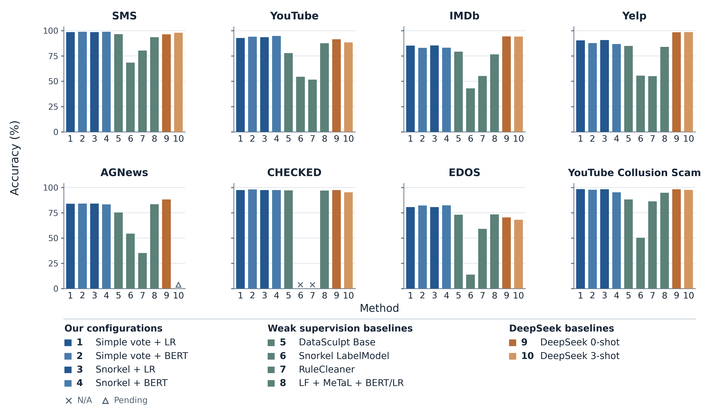
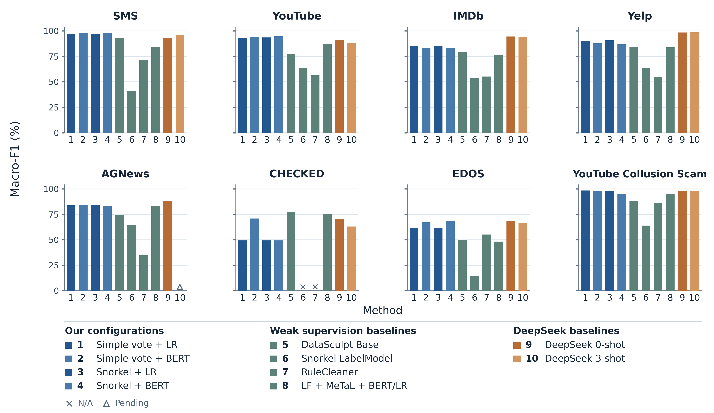
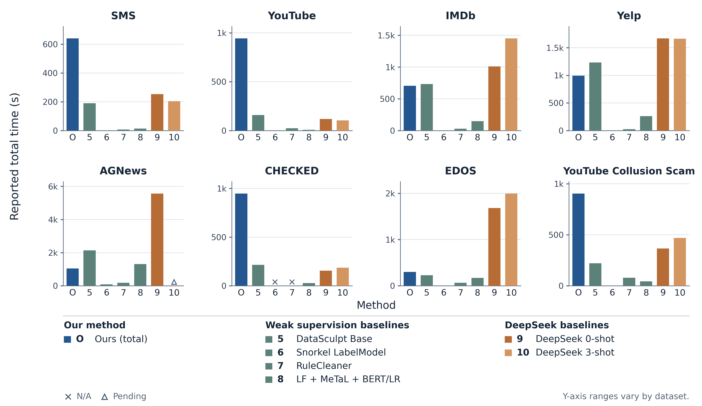
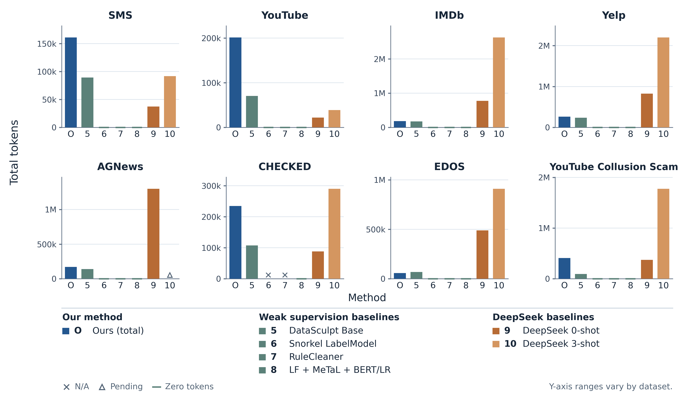

# 基于agent规则迭代分类

# Abstract

# 1 Introduction

# 2 Related Work

# 3 Preliminary

# 4 Methodology

我们提出一种基于双 Agent 协作的标注函数迭代优化框架，包括质量诊断、编辑规划、候选生成与校验、候选验收四个环节。每轮以当前保留的标注函数集合为起点：系统构建诊断反馈，Analyzer 据此选择编辑类型并提出方案，Patcher 与本地程序按操作类型生成候选。通过技术校验的候选进入质量评估；达到验收门槛才替换当前集合，否则保留当前集合，并在剩余预算内继续尝试。

## 4\.1 问题定义

设未标注训练集为 $\mathcal{D}_u=\{x_i\}_{i=1}^{N}$，带标签的开发集为 $\mathcal{D}_v=\{(x_i,y_i)\}_{i=1}^{M}$，测试集为 $\mathcal{D}_{te}$。

其中，$x_i\in\mathcal X$ 表示输入文本，$y_i\in\mathcal Y$ 表示其真实类别，标签空间为

$ \mathcal Y=\{0,1,\ldots,K-1\} $

其中，$K=|\mathcal Y|$ 为任务的类别数量。例如，在 SMS 垃圾短信识别任务中，$K=2$，类别 0 和 1 分别表示正常短信与垃圾短信。

弱监督知识由一组标签函数（labeling functions，LFs）表示。第 $t$ 轮的标签函数集合记为

$\Lambda^{(t)} = \{\lambda_1^{(t)},\ldots,\lambda_{m_t}^{(t)}\}$

其中，$m_t$ 为当前 LF 的数量，每个标注函数定义为

$ \lambda_j^{(t)}:\mathcal X\rightarrow\mathcal Y\cup\{-1\} $

其中，$-1$ 表示弃权。每个 LF 接收单条输入文本，根据关键词组合、正则表达式或局部文本模式输出对应类别；当输入不满足规则条件时，返回弃权。

对任意数据集合 $\mathcal{D}$ 执行全部标签函数，可得到投票矩阵

$ L_{\mathcal{D}}^{(t)}[i,j] = \lambda_j^{(t)}(x_i)$

聚合器根据投票矩阵生成弱标签 $\hat y_i^{(t)}$，这些标签随后用于训练下游分类模型。我们的目标是在有限的规则编辑预算内，利用开发反馈改善标签函数集合，使其在覆盖更多样本的同时控制误标，并提高弱标签对下游学习的有效性。

训练集真实标签不参与规则分析、标签模型拟合或下游模型训练。带标签的验证集（用作开发集）用于规则反馈、类别先验估计和模型选择。测试集仅用于报告评估结果，不参与规则反馈、候选验收或模型选择。

## 4\.2 框架概览

框架从一个预置的标签函数集合 $\Lambda^{(0)}$ 出发，重复执行以下过程：

$ \begin{aligned} \Lambda^{(t)} &\xrightarrow{\text{质量诊断}}\mathcal F^{(t)} \xrightarrow{\text{Analyzer}}\mathcal P^{(t)}\\ &\xrightarrow{\text{Patcher与结构校验}} \widetilde{\Lambda}^{(t+1)} \xrightarrow{\text{质量评估与决策}} \Lambda^{(t+1)} \end{aligned} $

其中，$\mathcal{F}^{(t)}$ 为当前版本的开发反馈，$\mathcal{P}^{(t)}$ 为结构化编辑方案。

每轮首先在固定数据划分上执行当前标签函数，计算训练集投票统计和验证集分类指标。Analyzer 根据这些信息选择本轮的优化方向，并提出一组具有统一操作类型的规则编辑。Patcher 根据方案生成或修改目标函数，本地程序负责合并代码、检查修改范围并验证运行结果。通过结构和执行校验的候选版本进入质量评估阶段。系统根据候选版本相对于当前版本的弱标签质量变化决定是否接受本轮修改；若候选被拒绝，则保留当前 LF 集合，并在后续迭代中重新规划编辑方案。

Analyzer 与 Patcher 是承担不同职责的两类 LLM 调用：前者负责确定修改目标及匹配思路，后者负责实现已经确定的方案。

例如 SMS 的初始 LFS 版本包含六个标签函数，分别覆盖奖品领取、免费推广、退订指令、简短回复、家庭关系和见面出行等模式。该初始化提供了可执行的规则起点，后续迭代围绕其覆盖缺口和误标行为展开，不断进行修正与拓展

## 4\.3 LFs 质量诊断与反馈构建

### 4\.3\.1 全局统计与局部规则质量

仅根据聚合后的分类指标，难以区分错误来自规则未覆盖、规则误标还是投票冲突。因此，我们同时构建集合层面和单个标签函数层面的诊断信息。

对于数据集合 $\mathcal{D}$，定义标签函数覆盖率为

$ C_{\mathrm{LF}}(\mathcal{D}) = \frac{1}{|\mathcal{D}|} \sum_{i=1}^{|\mathcal{D}|} \mathbf{1}\!\left[ \exists j,\;L_{\mathcal{D}}[i,j]\neq-1 \right]$

该指标衡量至少获得一张有效投票的样本比例。

相应地，聚合输出覆盖率定义为

$C_{\mathrm{out}}(\mathcal{D}) = \frac{1}{|\mathcal{D}|} \sum_{i=1}^{|\mathcal{D}|} \mathbf{1}[\hat y_i\neq-1]$

两者分别描述规则的触达范围和聚合器实际输出标签的范围。例如，简单多数投票在平票时弃权，因此具有 LF 覆盖的样本仍可能没有聚合标签。

**单条 LF 层面。** 对第 $j$ 条 LF，记其在验证集上给出非弃权投票的样本索引集合为 $\mathcal I_j=\{i:L_{\mathcal D_v}[i,j]\neq -1\}$。当 $|\mathcal I_j|>0$ 时，该 LF 的验证准确率定义为：

$ \mathrm{Acc}_{j} = \frac{1}{|\mathcal I_j|} \sum_{i\in\mathcal I_j} \mathbf{1}\!\left[L_{\mathcal D_v}[i,j]=y_i^{v}\right]$

其中 $y_i^{v}$ 为验证集样本的真实标签。若该 LF 在验证集上全部弃权，则不计算其准确率。反馈同时提供该 LF 在验证集上的有效投票数和训练集上的覆盖率，帮助 Analyzer 区分**触发少但命中较准**与**覆盖较广但容易误标**的规则。

### 4\.3\.2 分组样例反馈

为将统计现象对应到具体文本模式，我们构造五组反馈样例：

|**样例组**|**选择条件**|**主要用途**|
|---|---|---|
|验证集错误样例|聚合器输出非弃权标签，但预测错误|定位误标模式|
|验证集弃权样例|聚合器未输出类别|识别覆盖缺口|
|验证集正确样例|聚合预测与真实标签一致|为保留已有正确行为提供依据|
|训练集未覆盖样例|全部标签函数弃权|发现尚未建模的文本模式|
|训练集冲突样例|同时存在正常和垃圾短信投票（以SMS二分类为例）|分析规则边界与重叠|

每组最多抽取 $H$ 条样例。当前实现设置 $H=30$，因此每轮最多包含 150 条样例记录。抽样使用随机种子与版本标识共同确定，使相同版本的反馈能够重复生成。

验证样例包含正文、真实标签、当前聚合预测和 LF 投票；训练样例仅包含正文和投票，不附带真实标签。为减少输入长度，样例中的投票采用稀疏表示，只保留非弃权项，同时提供完整 LF 名单。因此，未出现的 LF 可被明确解释为弃权。

最终反馈由当前 LF 源码、验证指标、类别覆盖情况、训练统计、单个 LF 质量和五组样例共同组成。输入通过字段白名单构建，测试集正文、标签和指标不进入 Analyzer 的分析上下文。

## 4\.4 覆盖感知的规则编辑规划

规则优化需要同时考虑覆盖范围与标签质量。覆盖不足时，即使已覆盖样本的准确率较高，仍有大量训练文本无法提供监督；覆盖较充分时，继续扩张规则则可能引入更多误标。为此，我们根据当前训练集和验证集的 LF 覆盖率构造优化上下文：

$g^{(t)} = \begin{cases} \text{优先增加正确覆盖}, & \min\!\left( C_{\mathrm{LF}}(\mathcal{D}_u), C_{\mathrm{LF}}(\mathcal{D}_v) \right)<\tau,\\ \text{优先改善规则质量}, & \text{其他情况}. \end{cases} $

其中，$\tau$ 为覆盖阈值，当前实现设置取$\tau=0.8$。该机制通过提示词引导 Analyzer 的分析重点，不构成显式求解的数值优化目标，也不强制规定具体编辑动作。例如，低覆盖状态下仍可优先删除有害规则，但需要在方案中解释其必要性。

Analyzer 每轮从新增、修改和删除三类动作中选择一种统一操作类型。其输出包括本轮摘要和若干编辑项，每个编辑项包含目标函数名、修改原因、反馈证据及实施计划。实施计划需要描述可复用的匹配模式、应保留的正确行为和明确的弃权边界。

设每轮编辑预算为 $B$，则方案满足

$ a^{(t)}\in \{\mathrm{add},\mathrm{modify},\mathrm{delete}\}, \qquad 1\leq|\mathcal{O}^{(t)}|\leq B$

当前实现取 $B=5$，且每轮全部编辑项使用同一种动作。新增操作对应当前不存在的函数，修改与删除操作指向已有函数，删除后至少保留三个 LF。

Analyzer 被要求从反馈中概括可迁移、可泛化的文本模式，而不能依据样本编号或完整短信建立标签查找表。

## 4\.5 代码生成与结构检验

为使编辑方案能够对应到可检查的代码变化，对于新增和修改操作，Patcher 根据结构化编辑方案生成目标 LF 的候选代码；对于删除操作，本地程序根据经过验证的目标函数标识直接移除指定 LF。本地程序将候选代码合并至原始 LF 集合，并利用 Python AST（抽象语法树） 对修改前后的代码进行结构解析与差异检查，以验证实际修改范围与规划操作的一致性。

候选代码经过三个层次的验证。

1. 结构检查要求生成内容与目标函数集合完全一致，不允许遗漏、重复或新增方案之外的函数。每个 LF 必须采用 `def lf_name(text)` 接口。AST 检查进一步限制跨 LF 调用、全局状态访问、文件操作及非允许的导入等行为，使候选保持为局部文本规则。

2. 本地程序根据源码位置合并目标函数，并比较前后版本的 AST，识别实际发生的新增、修改和删除。实际编辑集合必须与方案完全一致，且不能超过预算。仅改变格式或文档字符串不计为逻辑修改；共享模块结构和已有 LF 的相对顺序需要保持一致。

3. 候选 LF 在固定数据划分上实际执行，检查函数能否处理输入，以及输出是否为合法整数 $-1$、$0$ 或 $1$。只有通过结构、编辑范围和执行检查的候选才能完成本轮评价。

错误处理采用有限修复策略。Analyzer 的 JSON 解析或方案校验失败时，系统将原始上下文、原回复和具体错误返回给 Analyzer，最多纠正一次。对于新增或修改操作，代码生成和候选运行阶段共用一次额外修复机会；修复仍围绕原方案的操作类型与目标展开。

## 4\.6 弱标签聚合与下游模型

给定第 $t$ 轮的标签函数投票矩阵 $L^{(t)}$，我们分别采用 Snorkel 和简单多数投票生成弱标签。记样本 $i$ 的投票向量为 $L_i^{(t)}$，类别 $c\in\{0,1\}$ 的票数及有效投票总数分别为

$ n_{ic}^{(t)} = \sum_{j=1}^{m_t} \mathbf{1}[L_{ij}^{(t)}=c], \qquad s_i^{(t)} = n_{i0}^{(t)}+n_{i1}^{(t)}$

**Snorkel 聚合。** 每轮根据更新后的训练集投票矩阵重新拟合标签模型，得到类别分布

$ q_{i,S}^{(t)}(c) = q_{\theta^{(t)}}(y=c\mid L_i^{(t)})$

模型使用完整验证集估计的类别先验

$\pi_c = \frac{1}{M} \sum_{i=1}^{M} \mathbf{1}[y_i^{v}=c]$

其中 $M$ 为验证集样本数，$y_i^{v}$ 为验证标签。训练金标不参与标签模型拟合。

**简单多数投票。** 该聚合器忽略弃权票，以有效投票中的类别占比作为分数：

$ q_{i,V}^{(t)}(c) = \begin{cases} \dfrac{n_{ic}^{(t)}}{s_i^{(t)}}, & s_i^{(t)}>0,\\[6pt] \dfrac12, & s_i^{(t)}=0. \end{cases} $

该方法不拟合参数，也不使用类别先验。其类别分数仅表示票数占比，全弃权时的 $1/2$ 为保存结果所用的占位值，不代表校准后的预测概率。

对于聚合器 $a\in\{S,V\}$，统一定义弱标签为

$\hat y_{i,a}^{(t)} = \begin{cases} -1, & s_i^{(t)}=0 \ \text{或聚合结果平票},\\[2pt] \displaystyle\arg\max_{c\in\{0,1\}} q_{i,a}^{(t)}(c), & \text{其他情况}. \end{cases} $

## 4\.7 质量验证与自适应决策

在质量验证阶段，采用简单多数投票作为统一的质量评估聚合器，以减少标签模型参数估计对规则编辑决策的影响。

设第 $t$ 轮的候选 LF 集合为 $\widetilde{\Lambda}^{(t+1)}$。

系统基于带标签开发集（验证集）评估候选规则集合的弱标签质量，设标签空间包含 $K=|\mathcal Y|$ 个类别，开发集中真实类别为 $k$ 的样本数量为 $M_k$，分别统计聚合预测正确的样本数量 $C_k$、预测错误的样本数量 $W_k$ 和该类别总样本数 $M_k$。聚合器弃权的样本不计入正确或错误数量。

定义类别均衡的净标注收益：

$ Q(\Lambda)= \frac{1}{K} \sum_{k=1}^{K} \frac{C_k(\Lambda)-\alpha W_k(\Lambda)}{M_k} $

其中，$\alpha$ 为误标惩罚系数。本文主实验设置 $\alpha=1$，并通过消融实验分析该参数对结果的影响。

系统采用严格改进的候选接受规则：

$A^{(t)}= \mathbf1\left[ Q(\widetilde{\Lambda}^{(t+1)}) > Q(\Lambda^{(t)})+\epsilon \right] $

其中，$\epsilon$ 为预先设定的最小改善阈值，当前设置取$\epsilon=0.01$

根据决策结果更新 LF 集合：

$ \Lambda^{(t+1)}= \begin{cases} \widetilde{\Lambda}^{(t+1)},& A^{(t)}=1,\\ \Lambda^{(t)},& A^{(t)}=0. \end{cases}
$ 

对于被拒绝的候选 LFs ，系统保留原有 LF 集合，并在后续尝试中生成新的修改方案。

优化过程在连续 $P$ 个有效候选未被接受时终止，当前设置取$P=2$。每当候选 LFs 成功被接受，连续拒绝计数清零。

## 4\.8 下游模型与性能评估

为评估 LF 优化对下游分类任务的实际影响，在迭代优化结束后，系统冻结最终保留的标签函数集合，记为

$ \Lambda^*=\Lambda^{(T)} $

其中，$T$ 表示优化过程终止时的迭代轮次。

将最终 LF 集合 $\Lambda^*$ 应用于未标注训练集 $\mathcal D_u$，得到投票矩阵 $L_{\mathcal D_u}^*$。随后分别采用 Snorkel 标签模型和简单多数投票生成弱标签。对于聚合器 $a\in\{S,V\}$，仅保留非弃权样本，构建弱标注训练集：

$\widetilde{\mathcal D}_{u,a}^{*} = \left\{ (x_i,\hat y_{i,a}^{*}) \mid x_i\in\mathcal D_u,\; \hat y_{i,a}^{*}\neq-1 \right\}$ 

其中，$\hat y_{i,a}^{*}$ 表示聚合器 $a$ 基于最终 LF 集合生成的弱标签。

为评估弱标签在不同分类模型上的有效性，我们分别使用两种聚合器生成的弱标注训练集，训练基于 TF\-IDF 特征的逻辑回归（Logistic Regression，LR）分类器和基于 BERT 的文本分类模型。

模型训练完成后，在完整的独立测试集 $\mathcal D_{te}$ 上进行预测，并采用准确率（Accuracy）和宏平均 F1 值（Macro\-F1）衡量分类性能。与弱标签生成阶段允许弃权不同，下游分类模型对所有测试样本均输出类别预测。

下游模型不参与 LF 的迭代修复与候选验收，其测试性能仅用于评价最终优化得到的 LF 集合对下游分类任务的实际效果。

# 5\.Experiments

## 5\.1 数据集

|弱监督模型|下游模型|指标|SMS|Youtube|IMDb|Yelp|Agnews|CHECKED|EDOS|Youtube\_Collusion\_spam|
|---|---|---|---|---|---|---|---|---|---|---|
| ||LF覆盖率|87\.40%|70\.40%|29\.52%|84\.08%|56\.15%|91\.53%|43\.32%|80\.59%|
|简单投票|逻辑回归|Accuarcy|98\.60%|92\.80%|85\.28%|90\.39%|83\.89%|97\.41%|80\.70%|98\.44%|
|||Macro\-F1|96\.84%|92\.69%|85\.28%|90\.29%|83\.84%|49\.34%|61\.84%|98\.41%|
||Bert\-base\-cased|Accuarcy|99\.00%|94\.00%|83\.04%|87\.84%|84\.06%|98\.12%|82\.27%|97\.81%|
|||Macro\-F1|97\.77%|93\.96%|82\.99%|87\.71%|84\.12%|70\.95%|67\.17%|97\.78%|
|Snorkel|逻辑回归|Accuarcy|98\.60%|93\.60%|85\.40%|90\.82%|84\.12%|97\.41%|80\.70%|98\.28%|
|||Macro\-F1|96\.84%|93\.52%|85\.39%|90\.78%|84\.08%|49\.34%|61\.84%|98\.26%|
||Bert\-base\-cased|Accuarcy|99\.00%|94\.80%|83\.20%|86\.89%|83\.27%|97\.41%|82\.40%|95\.31%|
|||Macro\-F1|97\.77%|94\.75%|83\.19%|86\.88%|83\.24%|49\.34%|68\.63%|95\.26%|
|||Token消耗|161,100|201,445|181,052|262,288|170,215|234,677|57,483|409,910|
|||总耗时|640\.707秒|943\.354秒|705\.198秒|992\.082秒|1046\.191|946\.602秒|301\.53秒|903\.76秒|

## 5\.2 baseline

## 5\.2 基线方法

### 基于标注函数的弱监督分类

**DataSculpt Base\.** DataSculpt 通过大语言模型迭代生成标注函数。给定带标签的示例和待查询文本，模型提出由关键词条件和类别标签组成的候选函数。系统依据候选函数的准确性及其与已有函数的重叠程度进行筛选。保留的函数在条件满足时输出弱标签，否则弃权。训练阶段将多个函数的输出聚合为伪标签，并以此监督基于 BERT 文本表征的逻辑回归分类器。测试阶段由该分类器输出预测。 

**标注函数＋MeTaL＋BERT/LR。** 该基线以预先确定的标注函数作为弱监督来源。SMS、YouTube、IMDb、Yelp 和 AGNews 使用 WRENCH 发布的标注函数输出矩阵。CHECKED、EDOS 和 YouTube Collusion Scam 使用本实验根据任务定义与训练数据编写的关键词标注函数。MeTaL 聚合各标注函数输出的类别标签与弃权结果，并为至少被一条规则覆盖的训练样本选取聚合概率最高的类别作为伪标签。随后，以预训练 BERT 提取的文本表征为输入，以伪标签为监督信号，训练逻辑回归分类器。该基线与 DataSculpt Base 采用相同类型的下游分类器，用于比较固定标注函数与大语言模型自动生成的标注函数所提供的弱监督信号。

### 标注函数修复的配对对照

**Snorkel LabelModel\.** 该基线用于评估初始标注函数的聚合效果。首先执行各标注函数，构建以样本为行、标注函数为列的弱标签矩阵。Snorkel 标签模型利用不同标注函数在样本上的输出估计其可靠性，并将可能冲突的弱标签聚合为类别概率。对获得规则投票的测试样本，直接取聚合概率最高的类别作为预测。

**RuleCleaner\.** 该方法利用少量人工标注样本修复已有的标注函数。首先通过混合整数线性规划确定需要调整的规则输出，在满足准确性和标注证据约束的条件下，尽量减少对初始输出的改动。随后，在标注函数的决策树中加入判断条件，使修订后的规则产生目标输出。最终使用修复后的标注函数重新构建弱标签矩阵并拟合 Snorkel 标签模型，与修复前的聚合结果进行比较。

### 大语言模型直接分类

**DeepSeek 0\-shot\.** 该基线采用零样本提示进行文本分类。提示仅由任务描述、候选类别定义和待分类文本构成，DeepSeek 根据这些信息直接输出类别。该设置用于评估模型仅依据任务描述进行分类的能力。

**DeepSeek 3\-shot\.** 该基线采用少样本上下文学习。在任务描述和类别定义的基础上，将三条带标签的训练示例与待分类文本共同纳入提示。模型利用示例所展示的文本与类别之间的对应关系进行预测，模型参数在推理过程中保持固定。 

# 6 结论与展望

